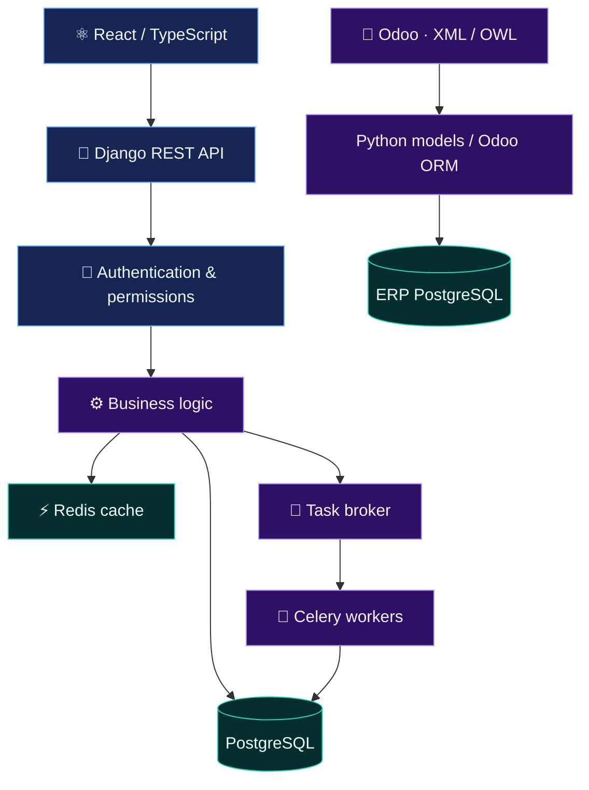

<!-- GitHub profile README for Sharatpsd. Paste this entire file into Sharatpsd/Sharatpsd/README.md. -->

### Building the backend. Connecting the business.

I turn business workflows into **APIs, enterprise modules, and maintainable systems**.

**Backend Engineer · Python & Django · Odoo 19 · Dhaka, Bangladesh 🇧🇩**

 

[About](#about) · [Tech Stack](#tech-stack) · [Projects](#projects) · [Experience](#experience) · [Research](#research) · [Connect](#connect)

 

## 👋 A little about me

I'm **Sharat Acharja Mugdho**, a backend engineer working with **Django, Django REST Framework, PostgreSQL, and Odoo**. I enjoy the part of engineering where data, business rules, and real user needs come together.

- 🏢 **Currently at Betopia Group** — developing and customizing Odoo 19 modules for business workflows.
- ⚙️ **Backend focus** — REST APIs, JWT authentication, role-based access control, and database-backed business logic.
- 🔄 **Beyond the request cycle** — Redis caching, Celery background tasks, and automated delivery workflows.
- 🎓 **B.Sc. in Computer Science & Engineering** — Green University of Bangladesh, January 2026.
- 🔬 **Research interest** — explainable deep learning for ocular disease classification.

> **My engineering approach:** clear contracts, explicit permissions, thoughtful data models, and code that stays understandable.

## 🧰 My engineering toolkit

**Backend & enterprise**

**Data & infrastructure**

**Frontend & tooling**

<b>🔎 Explore the full toolkit</b>

 

| Area | Technologies & practices |
| :--- | :--- |
| **Backend & APIs** | Python, Django, Django REST Framework, Celery, REST APIs, JWT, RBAC |
| **Enterprise ERP** | Odoo 19, Odoo ORM, XML Views, OWL, Actions & Menus, Access Rights, Record Rules |
| **Data & caching** | PostgreSQL, Redis, MySQL, SQLite |
| **Frontend** | React, TypeScript, JavaScript, Tailwind CSS, Vite |
| **Delivery & hosting** | Docker, Linux, GitHub Actions, Render, Vercel, Netlify, Cloudinary |
| **Developer tools** | Git, VS Code, Postman, Swagger |
| **AI & research** | PyTorch, scikit-learn, Pandas, ResNet50, Grad-CAM, SHAP |

 

## 🏗️ What I'm working on

### Enterprise ERP at Betopia Group

Connecting day-to-day business operations with customized **Odoo 19** modules.

| 🧩 Business logic | 🎨 ERP interfaces | 🔐 Access & operations |
| :--- | :--- | :--- |
| Python models & Odoo ORM | XML views & OWL | Access rights & record rules |
| Workflow customization | Actions & menus | PostgreSQL operations |
| Business process automation | Workflow-driven screens | Linux, Git & production debugging |

## 🚀 Featured projects

<table>
<tr>
<td width="50%" valign="top">

<h3>🍔 Bite</h3>
<b>Multi-role food delivery platform</b>

A connected ordering experience for customers, vendors, and administrators, built around authenticated APIs and role-aware workflows.

<ul>
<li>Customer, Vendor & Admin roles</li>
<li>JWT authentication & role-based access</li>
<li>Cart, checkout & order management</li>
</ul>

<code>Django</code> <code>DRF</code> <code>React</code> <code>PostgreSQL</code> <code>Tailwind CSS</code>

<a href="https://github.com/Sharatpsd/Food-Delivery-App-"><b>View code ↗</b></a> &nbsp;·&nbsp; <a href="https://bite-bd.onrender.com/"><b>Live demo ↗</b></a>

</td>
<td width="50%" valign="top">

<h3>🥛 Daily Dairy Shop</h3>
<b>E-commerce backend & delivery workflow</b>

A commerce system bringing products, inventory, shopping carts, and orders together with containerized deployment.

<ul>
<li>Product & inventory management</li>
<li>Shopping cart & order processing</li>
<li>Cloudinary media & GitHub Actions CI/CD</li>
</ul>

<code>Django</code> <code>PostgreSQL</code> <code>Docker</code> <code>Cloudinary</code> <code>GitHub Actions</code>

<a href="https://github.com/Sharatpsd/DailyDairyShop"><b>View code ↗</b></a> &nbsp;·&nbsp; <a href="https://dailydairyshop-3.onrender.com/"><b>Live demo ↗</b></a>

</td>
</tr>
<tr>
<td colspan="2" valign="top">

<h3>☕ Chai Order System</h3>
<b>Order management with asynchronous processing</b>

A modular Django backend combining dynamic pricing, role-aware order operations, background processing, and caching.

⚡ Celery background tasks &nbsp;·&nbsp; 🗃️ Redis caching &nbsp;·&nbsp; 🧩 Modular business logic

<code>Django</code> <code>Redis</code> <code>Celery</code> <code>SQLite</code> <code>Docker</code>

<a href="https://github.com/Sharatpsd/chai-order-system"><b>View code ↗</b></a> &nbsp;·&nbsp; <a href="https://chai-order-system-5.onrender.com/"><b>Live demo ↗</b></a>

</td>
</tr>
</table>

<a href="https://sharatpsd.netlify.app/"><b>Explore my portfolio →</b></a>

<b>🗺️ How the pieces fit together</b>

 

A simplified view of the backend and ERP patterns I work with:

## 💼 Experience & education

### 🟣 Trainee Executive — MIS & ERP
**Betopia Group · Dhaka**  
July 15, 2026 – Present

Odoo 19 module development and customization using Python, Odoo ORM, and XML views. Work includes business workflows, access rights, record rules, actions, menus, PostgreSQL operations, and production debugging with Linux and Git.

### 🔵 Backend Developer Intern
**Robo Tech Valley · Dhaka**  
2025

Developed Django REST Framework APIs, JWT and refresh-token workflows, and role-based access for multi-role applications. Worked on ORM/query optimization and frontend API integration.

[📄 View internship certificate](https://drive.google.com/file/d/1Jw82jFGXPvliJHYxBPOUh6oIlpm-j8mE/view)

### 🎓 B.Sc. in Computer Science & Engineering
**Green University of Bangladesh**  
Graduated January 2026

## 🔬 Research & explainable AI

### Explainable Deep Learning for Multi-Disease Ocular Classification and Severity-Aware Myopia Analysis

**IEEE-published research** focused on multi-disease retinal classification and interpretable model predictions.

- **Classification:** an end-to-end deep learning pipeline using ResNet50.
- **Visual explanations:** Grad-CAM for inspecting regions associated with predictions.
- **Interpretability:** SHAP to help examine model behavior.

[📑 Read the research paper →](https://drive.google.com/file/d/1XVzO6kOMtIVtVqfTo52M3sQzBVn16Mk2/view)

## 🌱 Currently exploring

**FastAPI** · **Advanced PostgreSQL** · **Redis patterns** · **Celery at scale** · **System design** · **Cloud & DevOps** · **Odoo OWL**

## 🎯 Principles I build with

| Principle | What it means in practice |
| :--- | :--- |
| 🔌 **API-first design** | Clear contracts and predictable behavior |
| 🔐 **Explicit access control** | Authentication and authorization designed into the system |
| 🗃️ **Database-aware development** | Data models and queries shaped by real access patterns |
| ⚡ **Responsive workflows** | Background processing for work that can leave the request path |
| 🧩 **Maintainable architecture** | Focused modules, clear responsibilities, and understandable code |
| 🔍 **Evidence-driven delivery** | Production debugging, automation, and inspectable behavior |

<b>📊 GitHub activity</b>

 

[View my contributions on GitHub →](https://github.com/Sharatpsd?tab=overview)

 

### 📸 Beyond the keyboard

Photography &nbsp;·&nbsp; Travel &nbsp;·&nbsp; Football &nbsp;·&nbsp; Real Madrid ⚽

---

## 🤝 Let's build something useful

**Backend systems · Enterprise software · Thoughtful APIs**

Have a project or an engineering idea in mind? Let's connect.

 

📍 **Dhaka, Bangladesh**

